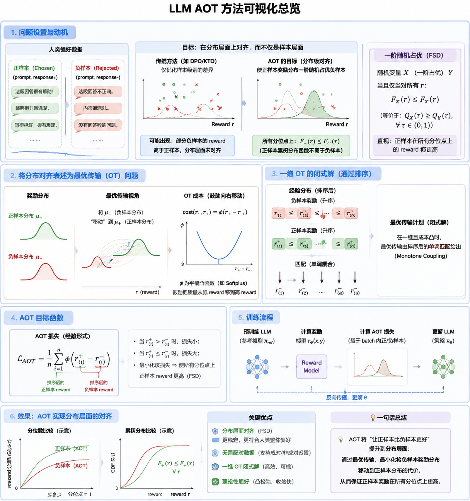

## 一句话直觉

==把“逐对分出胜负”提升为“好回答的奖励分布在各分位点都占优”。==

## 先理解问题

DPO常在同一提示下比较chosen与rejected，但真实资料也可能只有分别收集的好、坏回答。即使训练平均损失下降，奖励分布的某些尾部仍可能较差。因此先要分清“平均奖励高”“每对关系成立”“分布的一阶随机占优”是不同要求。

## 方法如何工作

AOT用==一阶随机占优==表述目标：好样本奖励的每个分位数都不低于坏样本。它把违反该关系的程度写成凸代价的一维最优传输问题；对经验样本排序后，把第i小与第i小配对，再计算违反占优的损失。成对版本比较当前策略和参考策略的chosen/rejected对数比；非成对版本比较正负样本的策略/参考对数比，二者不要混写。

## 放回偏好对齐的地图

改变的是批量样本之间的耦合方式，而不只是给每个DPO样本乘一个权重。排序在每步决定配对，梯度随后沿当前配对传播；一维可排序是计算高效的关键，不能直接类推为任意高维OT都同样便宜。

## 阅读边界

有限小批量估计的分位数会波动；不同提示混合后的分布占优也不自动保证每个提示都改善。原文中的统计保证有有界性、函数类等条件，不能解释为任意LLM训练的全局最优保证。

## 定义摘记（原文第2节）

$$X\succeq_{\mathrm{FSD}}Y\quad\Longleftrightarrow\quad Q_X(u)\ge Q_Y(u),\ \forall u\in[0,1].$$

这里$Q_X$、$Q_Y$是分位数函数；均值不等式不足以替代逐分位点要求。

## 自测与动手

1. 为什么正样本均值更高，仍可能没有一阶随机占优？试构造两组离散奖励。
2. 成对AOT与非成对AOT排序的随机变量分别是什么？

**小实验（自学设计）：**用两组各20个标量奖励，比较随机配对损失与排序配对损失；画分位数差曲线，再将少量低质量正样本注入尾部，观察均值和占优违反率如何分离。

## 来源与阅读范围

[论文原文](https://arxiv.org/abs/2406.05882)。已对照全文第2—3节（FSD定义、成对/非成对版本、排序算法）；这份笔记聚焦这些章节，并未独立复现实验。

原清单摘录与附图（保留原始表述）

以下内容来自原研究清单，可能包含旧标题、待验证的推测或尚未纠正的摘要。附图也可能是个人或 AI 辅助示意，未独立核验其出处与推导；阅读时以本页上方核验说明和论文原文为准。

**研究想法 #1**

问题：**现有偏好对齐方法通常只在“样本对”层面优化**，比如让某个 prompt 下 chosen response 的隐式 reward 高于 rejected response。**作者认为这不等于“分布层面”的对齐**，因为模型可能只是在平均意义或局部样本上变好，而不是让所有分位点上的 chosen reward 分布都整体优于 rejected reward 分布。另一个问题是，很多偏好数据并不是严格成对的 chosen/rejected，而是只有正样本集合和负样本集合，**传统 DPO 类方法不太适合这种 unpaired setting。**

方法：把偏好对齐定义为一种 一阶随机占优 FSD：**chosen responses 的 reward 分布应该在分布意义上优于 rejected responses 的 reward 分布，也就是各个分位数上 chosen 都应更高。**

总结：**不是只要求每对好坏答案分出胜负，而是要求好答案整体分布都比坏答案更好。****排序后一一比较，是一种合理又高效的分布对齐方法。**

<figure><figcaption>原研究清单配图；出处与推导未独立核验。</figcaption></figure>

