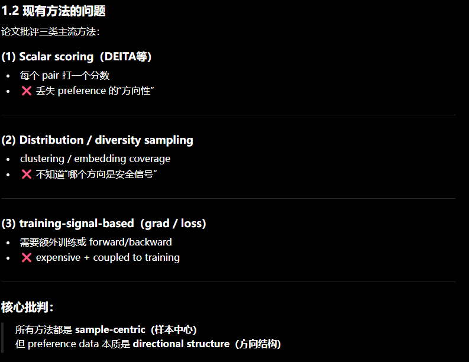
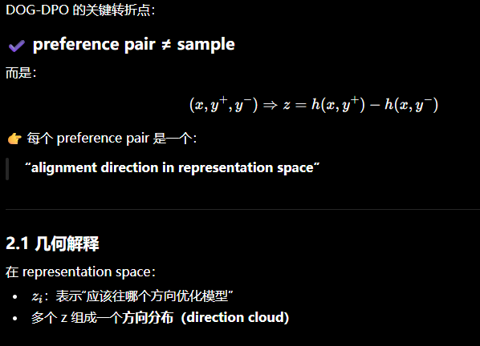
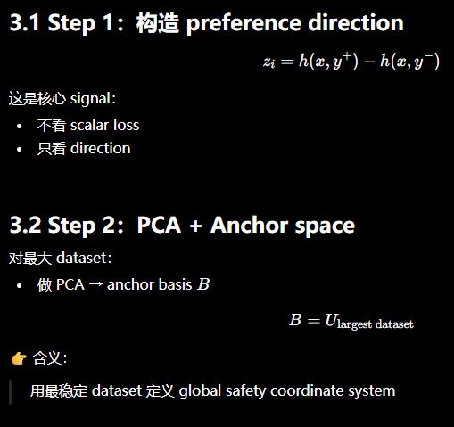
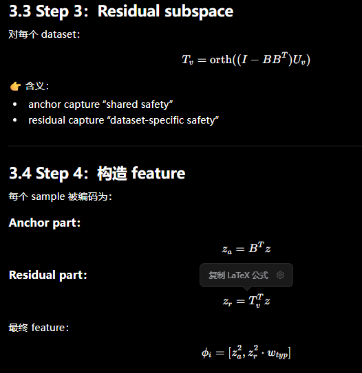
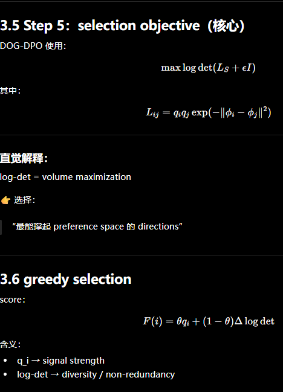
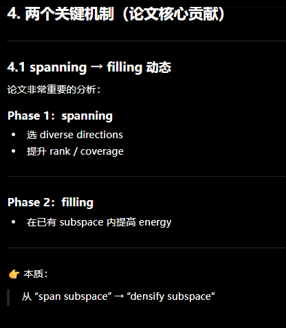
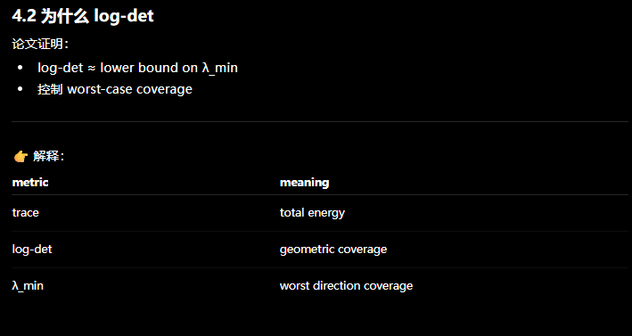
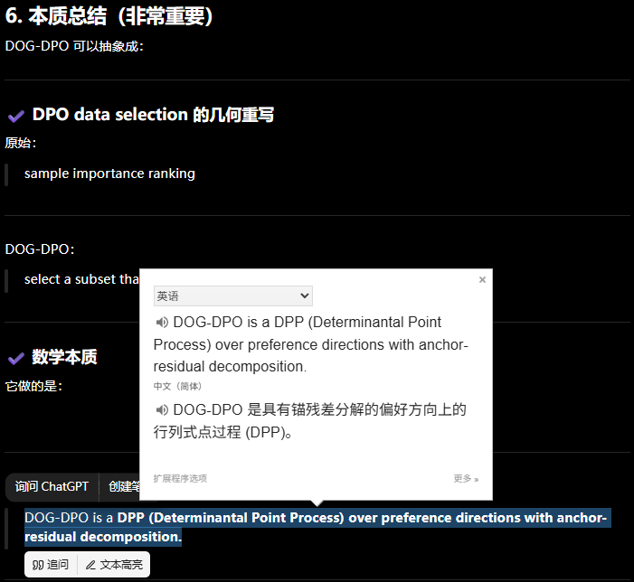

## 一句话直觉

==筛安全偏好数据时，覆盖不同的改变方向比收集许多相似高分样本更重要。==

## 先理解问题

安全偏好数据常包含冗余，同类拒绝模板反复出现，而少数风险方向覆盖不足。逐对打质量分或整体多样性分，会把“从坏回答向好回答变化的方向”压成一个标量，丢失结构。

## 方法如何工作

DOG-DPO把每对偏好表示为模型表征空间中的方向，再分解多数据集共享的全局锚子空间与数据集特定残差子空间。随后以多样性覆盖为目标==选择非冗余子集==，最后才运行DPO训练。原清单中更细的投影能量与残差加权应对照全文实现，不在摘要层面擅自补公式。

## 放回偏好对齐的地图

它是训练前数据选择框架，“training-free”描述的是选择过程无需额外训练，不表示最终DPO不训练。与GEOALIGN的在线rollout修正、可信方向的梯度投影都以方向为信号，但操作对象分别是数据、rollout与梯度。

## 阅读边界

表征几何来自特定骨干，换模型后方向是否仍有效需检查。低频风险可能因方向离群而被低估；总体安全成绩提升也不能代替逐风险覆盖评价。

## 自测与动手

1. 两个质量相近的偏好对，为什么可能提供完全不同的安全方向？
2. 怎样区分去掉冗余与误删少数关键风险样本？

**小实验（自学设计）：**在固定数据预算下比较随机、标量质量筛选和几何覆盖筛选；按风险类型报告安全性与有用性，并测选中向量的覆盖率，检查收益是否只是来自某个大类数据。

## 来源与阅读范围

[论文原文](https://arxiv.org/abs/2606.07678)。已核对正式论文页面的题名与摘要；机制解释同时参照原研究清单，具体公式、证明与实验配置仍需阅读全文。

原清单摘录与附图（保留原始表述）

以下内容来自原研究清单，可能包含旧标题、待验证的推测或尚未纠正的摘要。附图也可能是个人或 AI 辅助示意，未独立核验其出处与推导；阅读时以本页上方核验说明和论文原文为准。

**研究想法 #17**

1\.问题

如何从大规模 safety preference 数据中，选择“最有效的子集”来训练 DPO，从而减少冗余、提升安全对齐效率。

<figure><figcaption>原研究清单配图；出处与推导未独立核验。</figcaption></figure>

2\.做法

<figure><figcaption>原研究清单配图；出处与推导未独立核验。</figcaption></figure>

方法本质是一个：

> **geometry\-driven subset selection \(DPP\-style optimization\)**
>
> 这是核心 signal：
>
> - 不看 scalar loss
>
> - 只看 direction
>
>

<figure><figcaption>原研究清单配图；出处与推导未独立核验。</figcaption></figure>

<figure><figcaption>原研究清单配图；出处与推导未独立核验。</figcaption></figure>

**关键点：**

- 用 **energy \(squared projection\)** 表示 strength

- residual 用 Mahalanobis weighting suppress noise

<figure><figcaption>原研究清单配图；出处与推导未独立核验。</figcaption></figure>

<figure><figcaption>原研究清单配图；出处与推导未独立核验。</figcaption></figure>

<figure><figcaption>原研究清单配图；出处与推导未独立核验。</figcaption></figure>

3\.总结

<figure><figcaption>原研究清单配图；出处与推导未独立核验。</figcaption></figure>

4\.迁移到diffusion\-dpo

DOG\-DPO 做的是：

> 在 preference pairs 上选“最有几何覆盖”的子集
>
>

要迁移到 diffusion：

