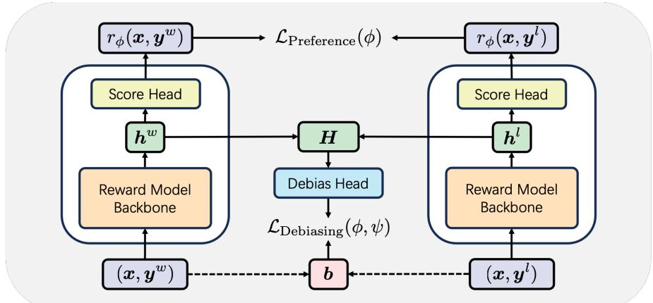

## 一句话直觉

如果好回答常常更长，奖励模型可能学成“越长越好”；需要让它关注质量本身，同时少依赖长度这种可被投机的线索。

## 问题与机制

DIR（Debiasing via Information optimization for RM）受信息瓶颈启发，一方面最大化奖励评分与人类偏好对之间的互信息，另一方面最小化评分与输入偏置属性的互信息。相比只用 Pearson 相关系数，互信息意在处理更复杂的非线性依赖。摘要具体评估长度、谄媚和格式三类偏置。==保留偏好信息与去除偏置需要同时优化==，否则常数奖励也能轻易“去相关”。

## 与通用正则的区别

它不是只让奖励更平滑或更不自信，而是明确指定希望减少依赖的属性。概念上可把互信息看作一个变量对另一个变量的信息量，零线性相关不保证没有非线性关系；因此仅画长度与分数的直线拟合不足以检验去偏。

## 阅读边界

==某个属性有时确实携带质量信息==，例如要求详细教程时长度并非纯粹坏因素。去偏的目标应是去除不合理捷径，而非强迫对所有任务都忽视该属性。互信息估计也受样本量与估计器影响，正文中的条件化方式和优化稳定性值得重点核对。

## 自测

1. 为什么一个恒定输出的奖励模型很“无偏相关”，却没有实用价值？
2. Pearson 相关为零时，分数是否仍可能强烈依赖长度？举一个非线性例子。

## 小实验（自学设计）

对同一内容生成长短、格式与语气的控制改写，让人工核验语义质量。比较去偏前后排序翻转率，同时保留确实需要长解释的任务，检验方法是否消除了捷径而未删除有用信号。

## 来源

[论文原文与摘要](https://arxiv.org/abs/2512.23461)。笔记中的自测与小实验为自学设计。

原清单摘录与附图（保留原始表述）

以下内容来自原研究清单，可能包含旧标题、待验证的推测或尚未纠正的摘要。附图也可能是个人或 AI 辅助示意，未独立核验其出处与推导；阅读时以本页上方核验说明和论文原文为准。

**研究想法 #71**

奖励模型（Reward Models，RMs）在基于人类反馈的强化学习（RLHF）中对于使大型语言模型（LLMs）与人类价值观保持一致至关重要。然而，RM的训练数据普遍被认为质量较低，包含的归纳偏差容易导致过拟合和奖励欺骗。例如，更详细且内容更全面的回答通常更受人类偏好，但由于字数较多，响应长度成为不可避免的归纳偏差之一。现有的少数RM去偏方法通常仅针对单一特定类型的偏差，或仅通过简单的线性相关性（如Pearson系数）来建模问题。为缓解奖励建模中更复杂且多样的归纳偏差，我们提出了**一种基于信息理论的新型去偏方法，称为基于信息优化的奖励模型去偏（Debiasing via Information optimization for RM，DIR）。受信息瓶颈（Information Bottleneck，IB）的启发，我们在最大化RM评分与人类偏好对之间的互信息（Mutual Information，MI）的同时，最小化RM输出与偏好输入中偏差属性之间的互信息**。基于信息理论的理论支持，DIR能够处理具有非线性相关性的更复杂偏差，显著拓展了RM去偏方法在实际应用中的适用范围。

<figure><figcaption>原研究清单配图；出处与推导未独立核验。</figcaption></figure>

