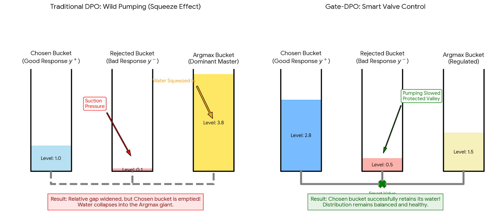
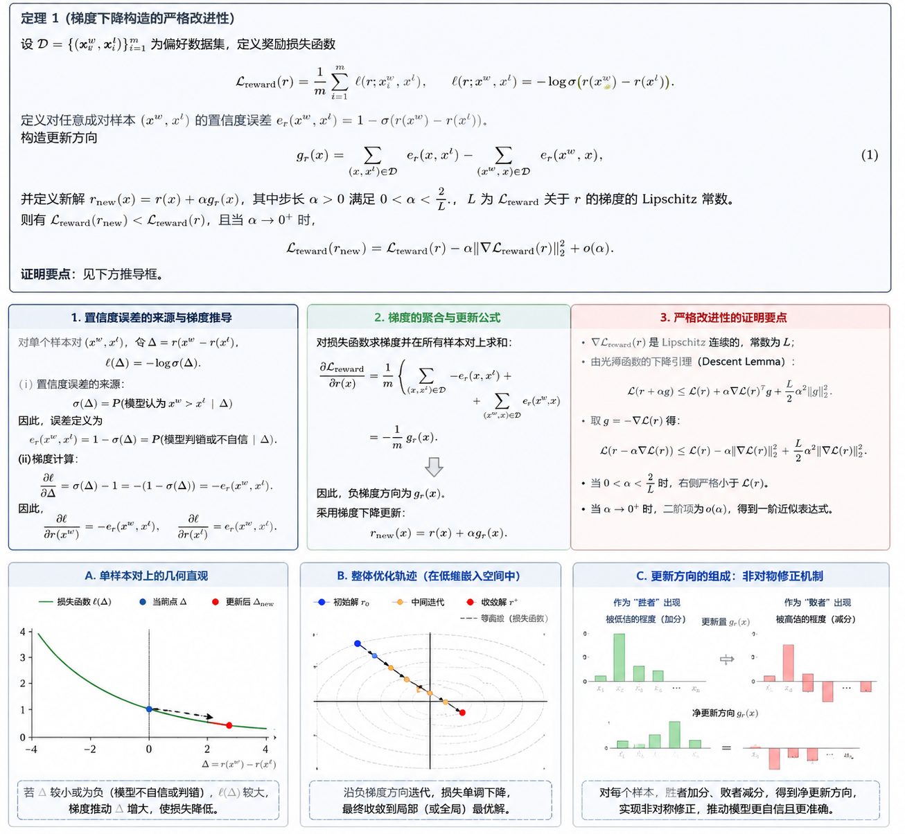
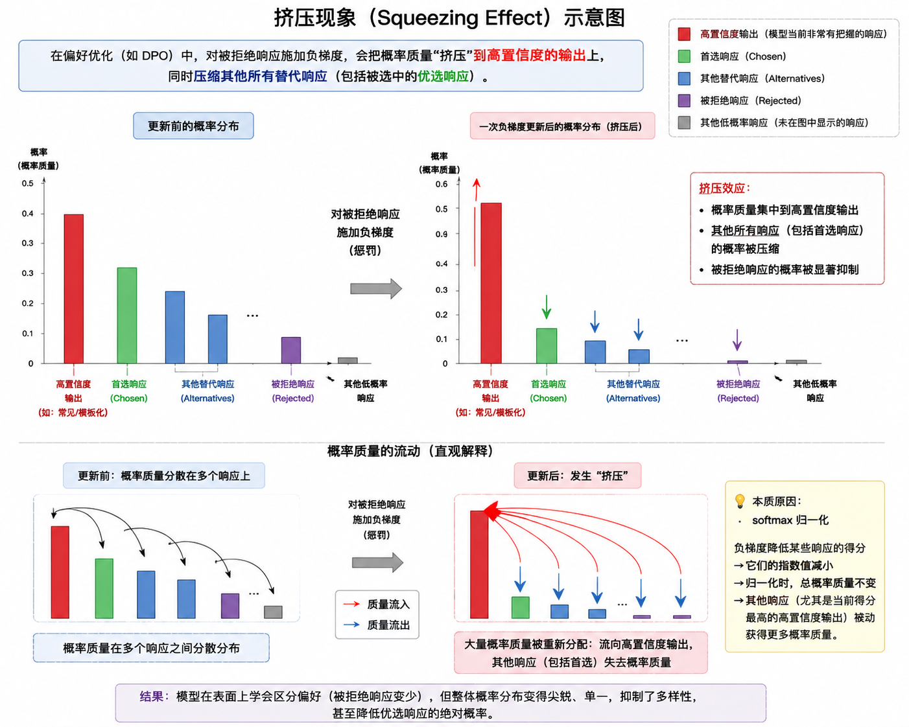
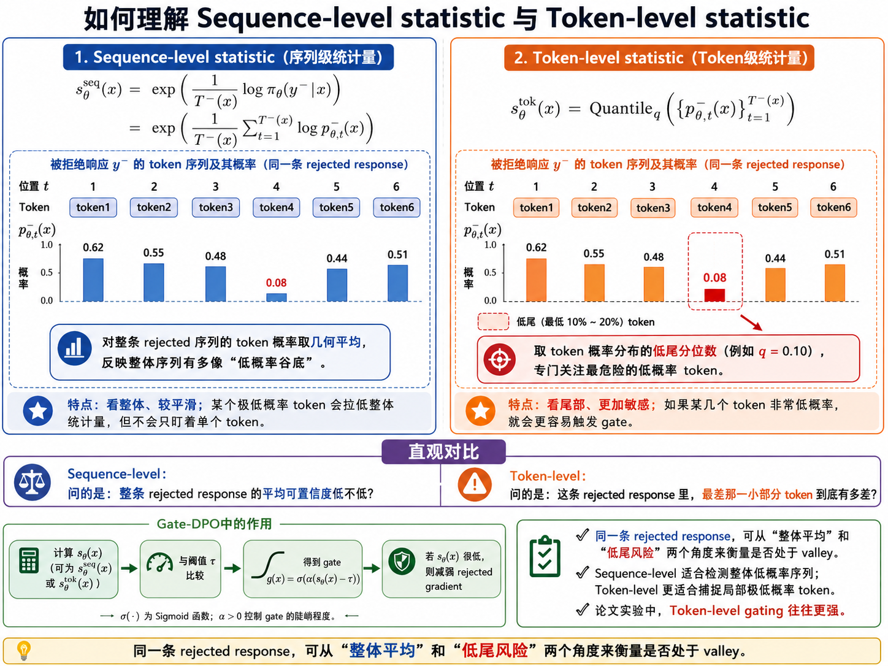
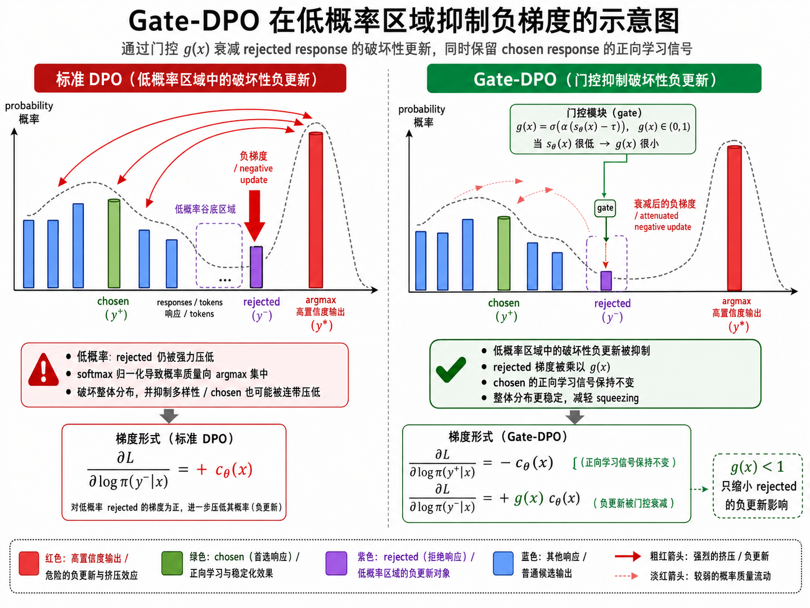

## 一句话直觉

==对已经很低概率的坏回答少施加一点负梯度，保护整体概率分布。==

## 先理解问题

DPO的相对间隔变大，并不意味着好回答绝对概率上升。softmax共享归一化，持续打压低概率rejected时，概率质量可能流向本已占优的输出，同时压低chosen和其他回答，这就是挤压效应。监控胜负准确率无法单独发现它。

## 方法如何工作

Gate-DPO先从rejected的token概率提取“谷底”统计量，例如token概率几何均值或低分位数，再经平滑sigmoid门控获得g。==g停止梯度后乘到拒绝项==；低概率区域门控较小，普通区域接近标准DPO。停止梯度避免模型通过改变门控统计量而获得额外捷径。

## 放回偏好对齐的地图

它主要干预chosen与rejected的相对梯度通路，可与校准类目标结合。应特别小心：拒绝项缩放也会改变外层sigmoid的共同系数，因此“chosen通路没有额外g”不等于“chosen参数梯度与标准DPO在数值上完全相同”。

## 阅读边界

门控可能同时削弱应被压低的坏回答，需要检查安全性与胜率；概率尺度受长度和token化影响。论文的质量评价包含初步实验，改善chosen似然本身不是最终人类偏好的充分证据。

## 机制摘记（原文第4节）

$$g=\operatorname{stopgrad}\!\left[\sigma\bigl(\alpha(s-\tau)\bigr)\right],\qquad z_g=\beta(\Delta_+-g\Delta_-).$$

其中$\Delta_\pm=\log\pi_\theta(y_\pm\mid x)-\log\pi_{\rm ref}(y_\pm\mid x)$，$s$是拒绝回答的概率谷统计量；外层损失仍为$-\log\sigma(z_g)$。

## 自测与动手

1. 为什么使用序列概率乘积可能让长回答被误判为更深的概率谷？
2. 停止梯度的门控与可微门控，在反向传播时多出或少了哪条路径？

**小实验（自学设计）：**用三分类softmax模拟chosen、rejected和第三个高概率类别，对比普通负更新与门控更新；同时画三者概率、间隔和熵，观察间隔增长时chosen能否仍下降。

## 来源与阅读范围

[论文原文](https://arxiv.org/abs/2605.02626)。已对照全文第3—4节与第6节的评价协议；这份笔记聚焦这些章节，并未独立复现实验。

原清单摘录与附图（保留原始表述）

以下内容来自原研究清单，可能包含旧标题、待验证的推测或尚未纠正的摘要。附图也可能是个人或 AI 辅助示意，未独立核验其出处与推导；阅读时以本页上方核验说明和论文原文为准。

**研究想法 #2**

问题：DPO 虽然简化了 RLHF，但它的梯度结构会带来一种 squeezing effect：DPO 对 chosen response 和 rejected response 施加大小相等、方向相反的梯度。**为了降低 rejected response 概率**，softmax 归一化可能把概率质量集中到少数高置信输出上，同时压低其他输出，甚至包括 chosen response。结果是**模型的 chosen/rejected 相对间隔可能变大，但 chosen 的绝对概率也下降，整体分布发生“概率塌缩”。**

方法：在 rejected response 的梯度上加一个平滑 gate。保留 DPO 提升 chosen/rejected 相对偏好的能力，但削弱对低概率 rejected response 的继续打压。

总结：**Gate\-DPO 是给 DPO 加了一个“别太用力压坏答案”的保护机制，防止训练把整体分布压坏。**

<figure><figcaption>原研究清单配图；出处与推导未独立核验。</figcaption></figure>

<figure><figcaption>原研究清单配图；出处与推导未独立核验。</figcaption></figure>

<figure><figcaption>原研究清单配图；出处与推导未独立核验。</figcaption></figure>

<figure><figcaption>原研究清单配图；出处与推导未独立核验。</figcaption></figure>

<figure><figcaption>原研究清单配图；出处与推导未独立核验。</figcaption></figure>

