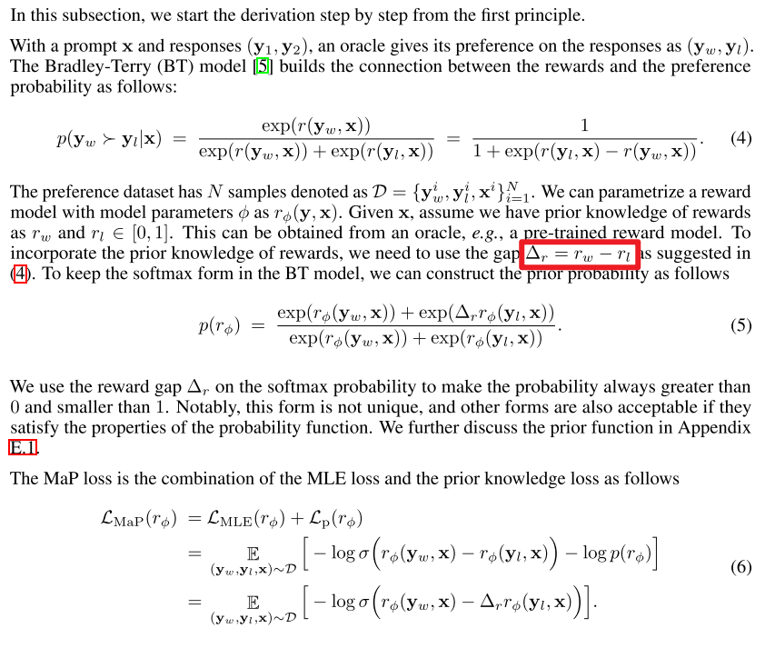

## 一句话直觉

==把先验奖励知识加到偏好学习里，让二元标签之外的质量信息参与校准。==

## 先理解问题

二元偏好只说谁更好，无法说明两个都很好还是一个极差。把偏好学习完全视为最大似然分类，可能产生过度惩罚与置信退化；如果已经拥有可靠的奖励先验，忽略它会丢失信息。

## 方法如何工作

MaPPO把最大似然式偏好优化扩展成最大后验目标，将==先验奖励估计纳入优化==。先验提供回答质量的补充参照，使模型不只依赖二元胜负信号；作者将其作为可与SimPO、IPO、CPO等方法结合的框架，并讨论离线和在线使用。

## 放回偏好对齐的地图

它与PPO的近端策略优化不是同一个缩写体系，也不是简单把RLHF多加一个先验模型。核心问题是先验如何进入偏好目标及其校准作用，而非“贝叶斯一定更稳健”。

## 阅读边界

先验如果带长度或风格偏置，后验也可能强化偏差。无额外超参数是作者对方法形式的陈述，实际奖励来源、温度和数据处理仍需要明确；应检查错误先验下的退化情况。

## 自测与动手

1. 二元标签相同的两对回答，先验奖励为何可能要求不同的更新力度？
2. 如果先验与真实偏好相反，怎样区分先验伤害和模型容量不足？

**小实验（自学设计）：**在合成偏好上分别提供准确、带噪、系统偏置先验，比较最大似然与最大后验目标的校准、chosen似然和最终效用；扫描先验错误程度以确定有益区间。

## 来源与阅读范围

[论文原文](https://arxiv.org/abs/2507.21183)。已核对正式论文页面的题名与摘要；机制解释同时参照原研究清单，具体公式、证明与实验配置仍需阅读全文。

**核验补充：**正式题名是Maximum a Posteriori，原清单a Posterior有拼写缺漏；方法不应与多智能体PPO混淆。

原清单摘录与附图（保留原始表述）

以下内容来自原研究清单，可能包含旧标题、待验证的推测或尚未纠正的摘要。附图也可能是个人或 AI 辅助示意，未独立核验其出处与推导；阅读时以本页上方核验说明和论文原文为准。

**研究想法 #35**

普漫大学、罗切斯特大学与延世大学介绍了 MaPPO方法，该方法**通过将先验奖励知识融入最大后验好优化目标，有效扩展了直接偏好优化范式，实现了在离线和在线环境中无都外超参款的偏好优化;**

并提升了大语言模型的对齐性能。这篇论文介绍了 MaPPO，一种旨在改进大型语言模型对齐效率的最大后验概率偏好优化方法。该研究指出，传统的 DPO 等方法因过度简化的二元分类机制，容易导致模型在高质量回答上出现**置信度退化或“挤压效应”**。MaPPO 通过在优化目标中引入先验奖励知识，根据回答的质量差异动态调整更新强度，从而实现了更精准的对齐。实验证明，该方法可作为插件无缝集成至 SimPO 和 IPO 等现有框架中，且无需额外超参数。

<figure><figcaption>原研究清单配图；出处与推导未独立核验。</figcaption></figure>

