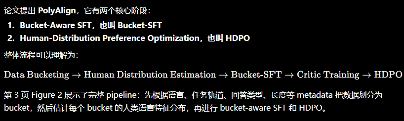
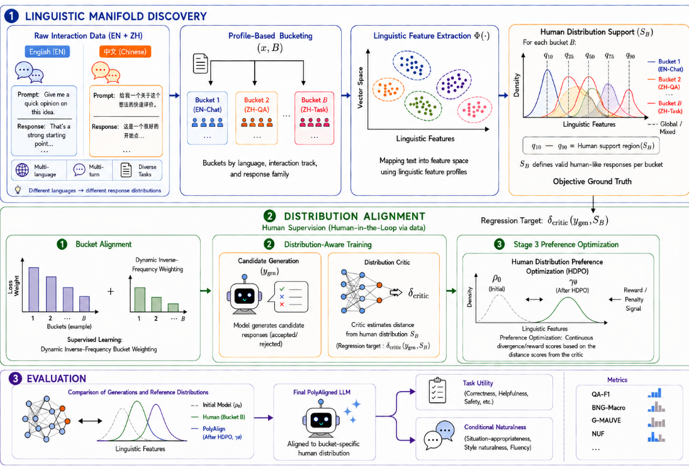
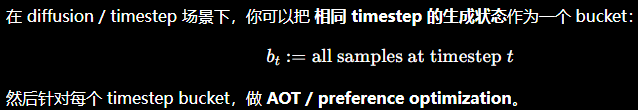

## 一句话直觉

==自然回答风格应随语言和交互场景变化，不能把所有人对齐到同一种助手口吻。==

## 先理解问题

全局SFT或偏好优化可能提高平均有用性，却压平不同语言、任务和对话形式里的自然差异。例如同样的简短回答，在一个交互场景合适，在另一个场景可能显得突兀；因此目标应是条件人类分布。

## 方法如何工作

PolyAlign按语言、交互轨道、回答家族和长度组织人类参考bucket。Bucket-Aware SFT平衡异质bucket的训练；HDPO利用critic估计样本到相应人类支持区域的距离，对偏好学习进行==条件分布约束==。要记住“条件”是目标定义的一部分，不能只比较全局混合分布。

## 放回偏好对齐的地图

与AOT的分位数随机占优不同，这里强调当前语境下的人类分布支持。与用户特定奖励也不同，bucket可以是语言或任务条件，而不必是一位具体用户。

## 阅读边界

分桶会引入粒度和样本量权衡，critic误差也可能把少数自然表达排除。原清单把扩散时间步视为bucket是研究假说；中间噪声状态没有现成人类回答分布，需先定义监督对象和可比性。

## 自测与动手

1. 为什么整体风格分布匹配，仍可能在每种语言条件下都不匹配？
2. bucket按长度划分时，如何避免模型仅学到长度而没有学到自然性？

**小实验（自学设计）：**选两种语言和两类对话场景，比较全局SFT、均衡分桶SFT、加条件分布约束；同时测任务正确率和每桶风格分布距离。扩散迁移另行定义每时间步的目标，不预设已经可行。

## 来源与阅读范围

[论文原文](https://arxiv.org/abs/2606.13227)。已核对正式论文页面的题名与摘要；机制解释同时参照原研究清单，具体公式、证明与实验配置仍需阅读全文。

原清单摘录与附图（保留原始表述）

以下内容来自原研究清单，可能包含旧标题、待验证的推测或尚未纠正的摘要。附图也可能是个人或 AI 辅助示意，未独立核验其出处与推导；阅读时以本页上方核验说明和论文原文为准。

**研究想法 #16**

**1\.问题**

现有 SFT、RLHF、DPO 等后训练方法，往往把模型对齐到一种“全局统一的助手风格”，但人类回答本来不是单一分布，而是会随语言、任务类型、对话场景、回答长度、表达风格而变化。模型应该匹配**当前交互条件下的人类回答分布**，而不是学成一种固定的“客服式”或“ChatGPT 式”回答风格。

**2\.做法**

<figure><figcaption>原研究清单配图；出处与推导未独立核验。</figcaption></figure>

<figure><figcaption>原研究清单配图；出处与推导未独立核验。</figcaption></figure>

**3\.总结：**

提出HDPO将DPO推广到分布级条件偏好优化，通过Bucket\-Aware SFT实现群体级细粒度对齐，突破传统单一偏好分布假设。

**4\.迁移到diffusion\-dpo**

<figure><figcaption>原研究清单配图；出处与推导未独立核验。</figcaption></figure>

**把 timestep 当作 bucket，并在每个 bucket 做 AOT（或类似 DPO/HDPO 优化）完全可行**，相当于把 PolyAlign 的 conditional human distribution 对齐思想推广到 diffusion latent 序列上。这样可以控制每个 timestep 的生成质量，避免 early / late step collapse 或 reward drift。

