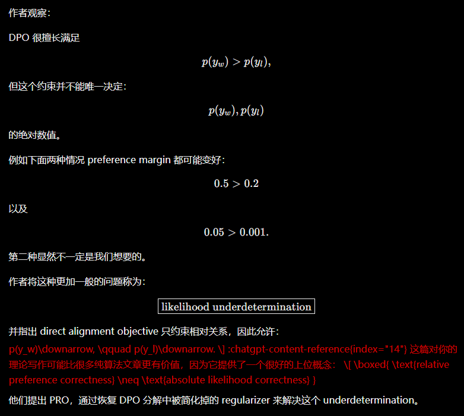

## 一句话直觉

只知道两个答案谁的概率比例更高，不足以确定模型究竟给这两个答案分配了多少总概率。

## 问题与机制

论文将这一局限称为 likelihood underdetermination：对比式目标可以满足相对偏好，却允许示例响应的绝对似然下降。作者重新分解 DPO 损失，指出标准实现隐式简化了重写后的一个正则项，再用完整正则的高效近似提出 PRoximalized PReference Optimization（PRO），同时处理 pairwise、binary 与 scalar 反馈。==问题是目标没有充分约束绝对质量，不只是优化器跑得不够好==。

## 一个可手算的例子（教学示意）

设还有“其他输出”，两种策略概率分别为 $(0.2,0.1,0.7)$ 和 $(0.02,0.01,0.97)$。chosen/rejected 比值都为 $2$，但这两个示例的绝对概率相差十倍。参考策略固定时，相对比值目标无法仅靠这一对区分它们。这帮助理解欠确定性，==不表示所有 DPO 训练必然沿第二条路径走==。

## 与似然位移的关系

位移描述训练中概率共同下降的现象，欠确定性则解释为何目标可能允许这样的解。恢复正则是在目标层面补约束。这里 PRO 的全名是 Proximalized Preference Optimization，应与更早的 Preference Ranking Optimization 同名缩写区分。

## 阅读边界

完整正则的推导、可计算近似与实现代价是复现重点，不能简单加一个随意 NLL 就宣称等价。不同反馈类型具有不同标度和噪声，统一框架不代表无需校准。

## 自测

1. 为什么上述两个三状态分布能有相同比值、不同绝对似然？
2. 增加一个锚定项能限制哪些自由度，又可能引入什么偏好？

## 小实验（自学设计）

实现三输出离散策略，对相同偏好对优化比值目标，改变初始“其他输出”的质量。记录比值与总示例概率，再加入明确锚定作对照，观察哪些解被排除；最后核对原文 PRO 正则与这个教学锚定的差别。

## 来源

[论文原文与摘要](https://arxiv.org/abs/2505.23316)。笔记中的自测与小实验为自学设计。

原清单摘录与附图（保留原始表述）

以下内容来自原研究清单，可能包含旧标题、待验证的推测或尚未纠正的摘要。附图也可能是个人或 AI 辅助示意，未独立核验其出处与推导；阅读时以本页上方核验说明和论文原文为准。

**研究想法 #89**

**Likelihood Underdetermination新现象**

<figure><figcaption>原研究清单配图；出处与推导未独立核验。</figcaption></figure>

