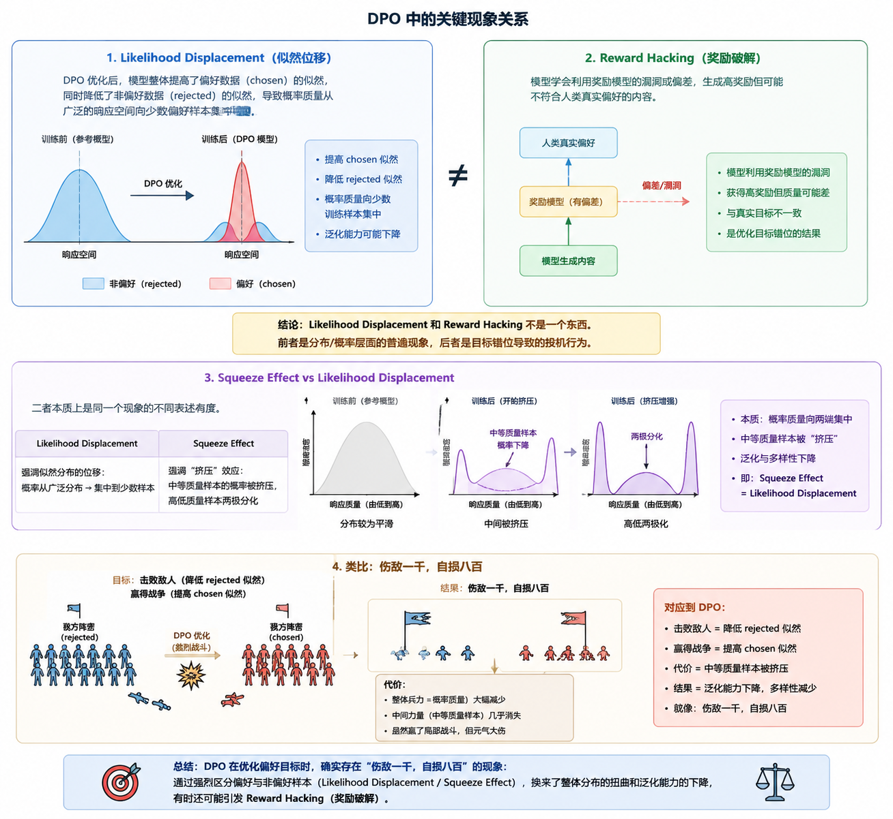

## 一句话直觉

==把抗尖锐度的扰动放到logit空间，用较低成本抑制偏好训练的高曲率失稳。==

## 先理解问题

挤压效应不仅可以从概率归一化解释，还可以从几何解释：在高曲率方向，负梯度造成的残差可能快速放大。只降低学习率可能同时减慢有用学习，因此需要更有针对性的曲率控制。

## 方法如何工作

论文建立逐坐标logit动态的理论框架，把负更新与高曲率方向的残差扩张联系起来。标准SAM考察参数邻域中较坏的损失，促使模型落在更平坦区域；logits-SAM==把扰动集中到输出层/logit相关空间==，以减少对整个大模型实施SAM的计算负担。它仍然围绕偏好损失进行优化。

## 放回偏好对齐的地图

Gate-DPO依据概率谷缩放拒绝梯度，本工作依据局部曲率稳定更新。两者关注同一失败症状，却作用于不同机制；不应因为都缓解chosen概率下降，就认定数学上等价。

## 阅读边界

“开销很小”是相对具体实现和模型而言；需要实测时间与显存。阅读时应检查logit空间与参数空间对应的近似条件、扰动半径以及平坦性指标能否预测最终胜率。

## 自测与动手

1. 参数空间平坦与logit空间平坦为什么不必完全一致？
2. 如果训练损失更平稳，但chosen似然仍下降，说明还缺少哪类观察？

**小实验（自学设计）：**在同一小模型、数据和训练步数下比较DPO、参数SAM和logits-SAM，记录吞吐、峰值显存、chosen似然与验证偏好胜率；把稳定性收益与额外算力分开报告。

## 来源与阅读范围

[论文原文](https://arxiv.org/abs/2603.18258)。已核对正式论文页面的题名与摘要；机制解释同时参照原研究清单，具体公式、证明与实验配置仍需阅读全文。

原清单摘录与附图（保留原始表述）

以下内容来自原研究清单，可能包含旧标题、待验证的推测或尚未纠正的摘要。附图也可能是个人或 AI 辅助示意，未独立核验其出处与推导；阅读时以本页上方核验说明和论文原文为准。

**研究想法 #4**

**问题：****DPO 存在“挤压效应”**，即训练中模型对偏好回答的概率会意外下降，其实质是负梯度更新导致残差**在高曲率方向迅速扩张**。

**做法：（曲率角度）**从参数与 Logit 空间的几何对应关系出发 ，将尖锐度感知最小化（SAM）的曲率正则化能力引入对齐训练。

<figure><figcaption>原研究清单配图；出处与推导未独立核验。</figcaption></figure>

