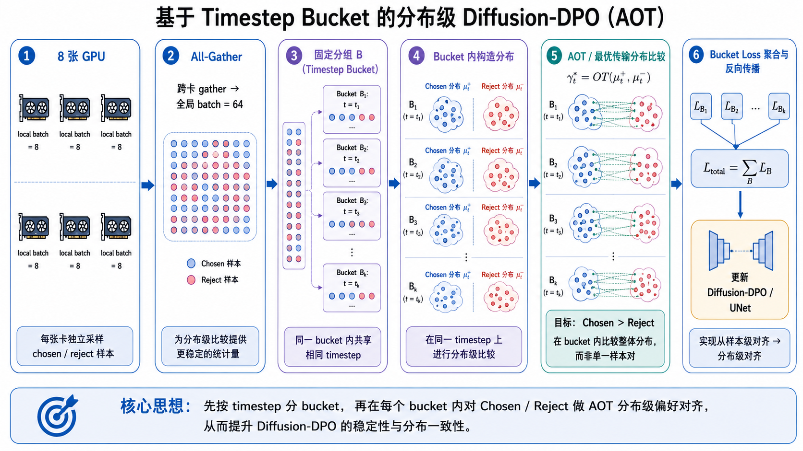
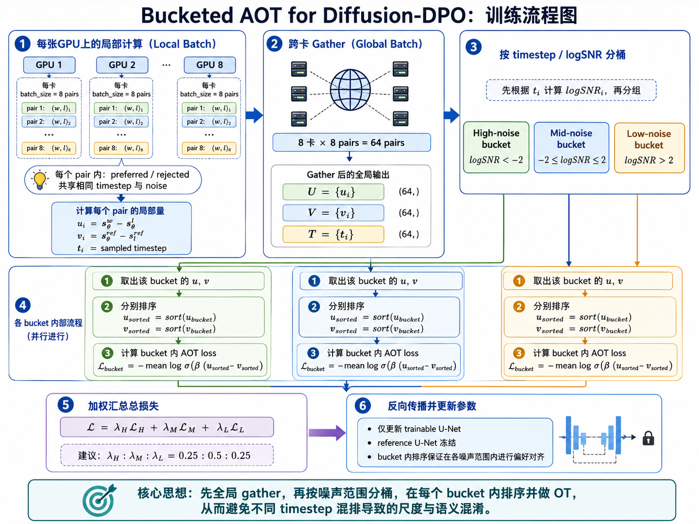

## 一句话直觉

==同一张图的奖励，不应不分时间和位置地平均施加到所有生成变量。==

## 先理解问题

最终图像得到一个分数，但不同去噪步骤和空间区域对这个分数的贡献不一样。提示中的文字、数量或局部物体通常只对应图像的一部分；均匀分配优势会让无关区域承受同样更新。

## 方法如何工作

STAR利用生成模型内部的文本—图像注意力，围绕提示中核心内容构造随时间步和rollout变化的空间分配图，再把相同组相对优势分配到更相关latent区域，用空间分辨的策略目标强化这些区域。外部奖励源保持相同，==改变的是信用分配==。

## 放回偏好对齐的地图

与改奖励函数不同，STAR研究“同一监督信号应该更新哪里”。与StitchVM预测中间价值也不同，它从已有优势出发进行时空分配；两者可能互补，但组合效果不能凭直觉认定。

## 阅读边界

注意力并非因果贡献的完美解释，提示解析也可能遗漏复杂关系。应检查局部强化是否损伤背景、整体构图和多样性，并比较额外注意力处理的真实计算成本。

## 自测与动手

1. 如果奖励只评价文字渲染，为何给整张图相同优势可能低效？
2. 当注意力指向错误区域时，局部分配会比均匀更新产生什么新风险？

**小实验（自学设计）：**固定模型和奖励，比较均匀分配、随机同稀疏度分配和STAR分配；在文字、数量与位置关系任务上分别评估，并检查非目标区域质量，排除只靠更稀疏更新的解释。

## 来源与阅读范围

[论文原文](https://arxiv.org/abs/2606.17979)。已核对正式论文页面的题名与摘要；机制解释同时参照原研究清单，具体公式、证明与实验配置仍需阅读全文。

原清单摘录与附图（保留原始表述）

以下内容来自原研究清单，可能包含旧标题、待验证的推测或尚未纠正的摘要。附图也可能是个人或 AI 辅助示意，未独立核验其出处与推导；阅读时以本页上方核验说明和论文原文为准。

**研究想法 #23**

研究问题：现有T2I的RL后训练方法将最终图像reward转换为单一标量优势并均匀施加到整个生成轨迹，忽视了T2I生成的时空结构——不同去噪步骤负责不同生成阶段，真正决定文本对齐的内容通常只在图像局部出现。

核心方法：提出STAR，利用生成模型内部的text\-image attention，从用户关心的核心内容出发，构造跨去噪步骤和rollout动态变化的空间分配图，将group\-relative优势分配到更相关的latent区域。

主要创新：实现粒度匹配的reward分配，几乎无额外计算开销。在SD3\.5 Medium上，GenEval达0\.9759、OCR达0\.9757、PickScore达23\.60。

关系：扩散模型对齐中reward分配的精细化和空间化进展。

<figure><figcaption>原研究清单配图；出处与推导未独立核验。</figcaption></figure>

<figure><figcaption>原研究清单配图；出处与推导未独立核验。</figcaption></figure>

