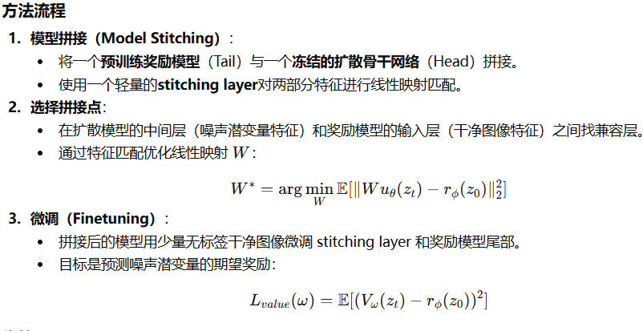
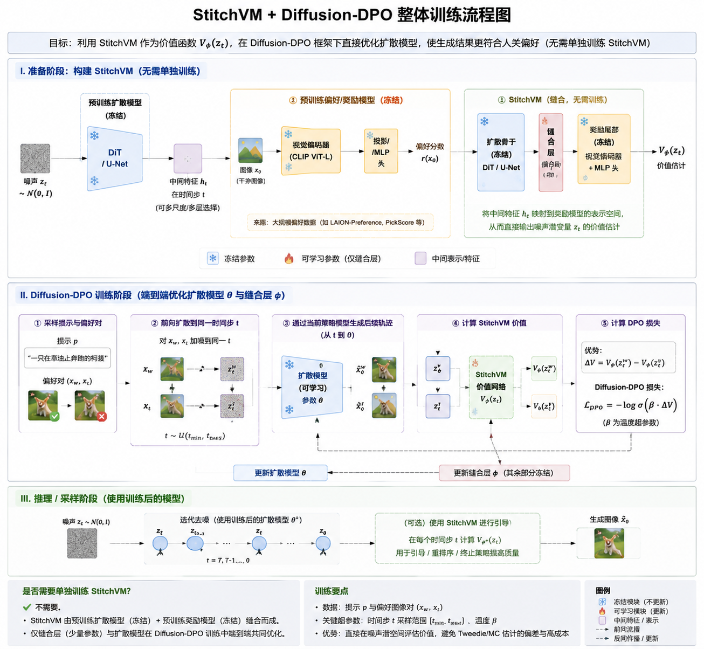
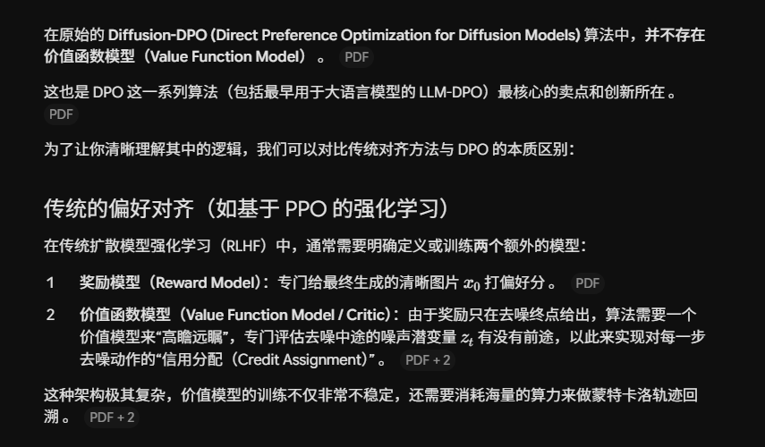
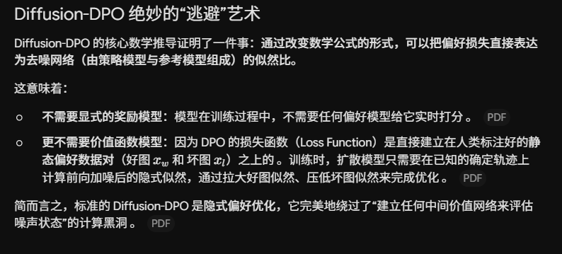
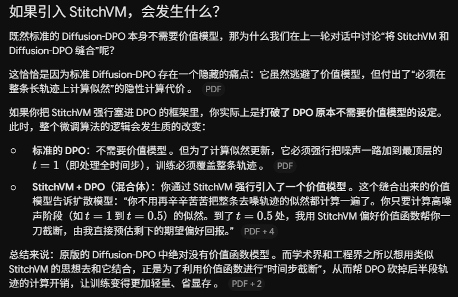

## 一句话直觉

==让干净图像奖励模型借用扩散主干的表征，直接给带噪中间状态估值。==

## 先理解问题

最终图像容易打分，中间带噪latent却没有清晰的像素语义。对每个中间状态跑完整生成轨迹做Monte Carlo较昂贵；用干净图像近似可能较快但有偏差。价值函数要回答的是“从这里继续生成，最终奖励大概是多少”。

## 方法如何工作

StitchVM把冻结扩散骨干的中间表征接到截断像素奖励模型的后段，并训练轻量缝合结构，把后者在干净图像上学到的评价能力迁移到噪声latent。核心是==复用两类预训练能力==，而非从零学一个通用价值网络；训练成本可以在后续多次steering和后训练中摊销。

## 放回偏好对齐的地图

它主要改进价值估计模块，不是直接替代DPO的偏好损失。原清单提出用它辅助Diffusion-DPO时间步截断，这是研究迁移猜想；原始DPO不因为引入价值网络就自动拥有无偏的截断估计。

## 阅读边界

需要检查不同噪声级别、骨干与奖励模型组合的校准及分布外表现。价值预测与最终奖励相关，也不保证梯度方向适合引导；应同时测预测误差、引导质量和总计算成本。

## 自测与动手

1. 为什么干净图像奖励模型不能直接可靠评价高噪声latent？
2. 一次训练价值模型与每次Monte Carlo rollout的成本，应该如何公平比较？

**小实验（自学设计）：**固定若干中间latent，各采样多条完整轨迹形成Monte Carlo均值作为参考，按时间步比较StitchVM预测误差；再在同等总算力下对比steering收益。迁移到DPO截断时需另外评估估计偏差。

## 来源与阅读范围

[论文原文](https://arxiv.org/abs/2605.19804)。已核对正式论文页面的题名与摘要；机制解释同时参照原研究清单，具体公式、证明与实验配置仍需阅读全文。

原清单摘录与附图（保留原始表述）

以下内容来自原研究清单，可能包含旧标题、待验证的推测或尚未纠正的摘要。附图也可能是个人或 AI 辅助示意，未独立核验其出处与推导；阅读时以本页上方核验说明和论文原文为准。

**研究想法 #5**

问题：现有的对齐方法在处理带有噪声的中间潜变量时，通常面临计算成本高（蒙特卡洛模拟）或估值偏差大（Tweedie近似）的难题

做法：StitchVM 的目标是 **直接在噪声潜变量上计算价值函数**，避免上述方法的高偏差或高成本问题。StitchVM 通过模型缝合技术，将预训练的扩散模型主干（作为头部）与截断的像素空间奖励模型（作为尾部）连接起来，从而直接在噪声潜空间中评估价值。

总结：

**StitchVM（Stitched Value Model）**

- 聚焦于 **生成对齐（diffusion alignment / steering）**：即让一个扩散模型的输出更符合某个**任务奖励/价值函数**（如提示忠实度、审美偏好等）。

- 解决的是 **价值函数如何在扩散噪声潜空间（noisy latents）上有效估计的问题**。

- 核心目标是 **构造一个能在噪声潜空间上预测奖励值（value）的模型**，便于后续对齐和 steering。

→ 它不是为了改善生成质量本身，而是为了**提高对齐精度和效率**。

<figure><figcaption>原研究清单配图；出处与推导未独立核验。</figcaption></figure>

迁移diffusion：

动机：**昂贵的 Monte Carlo 或 Tweedie 近似**

StitchVM 可以直接用作人类偏好评价的 value model，**不必依赖昂贵的 Monte Carlo 或 Tweedie 近似。**

<figure><figcaption>原研究清单配图；出处与推导未独立核验。</figcaption></figure>

原版的 Diffusion\-DPO 中绝对没有价值函数模型 \(\)。而学术界和工程界之所以想用类似 StitchVM 的思想去和它结合，正是为了利用价值函数进行“时间步截断”，从而帮 DPO 砍掉后半段轨迹的计算开销，让训练变得更加轻量、省显存

<figure><figcaption>原研究清单配图；出处与推导未独立核验。</figcaption></figure>

<figure><figcaption>原研究清单配图；出处与推导未独立核验。</figcaption></figure>

<figure><figcaption>原研究清单配图；出处与推导未独立核验。</figcaption></figure>

