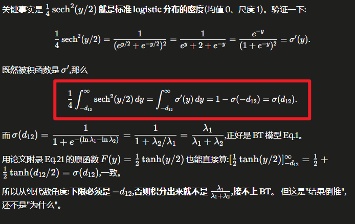
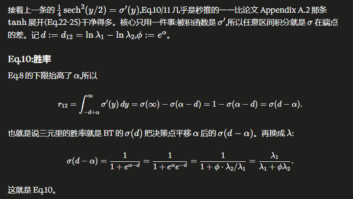
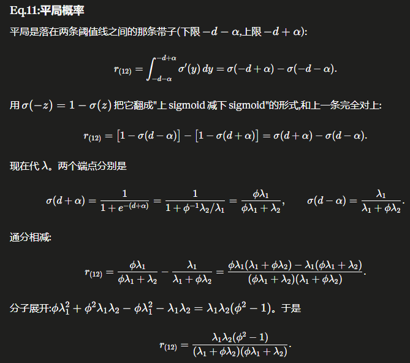
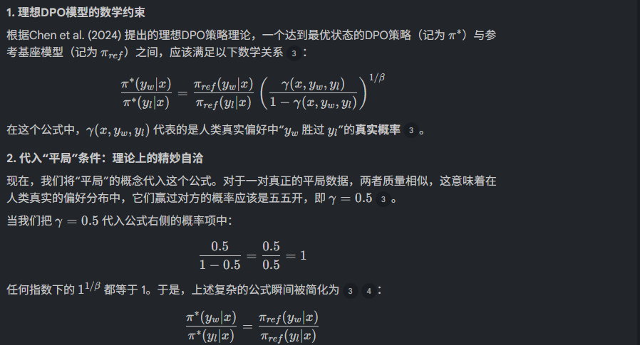
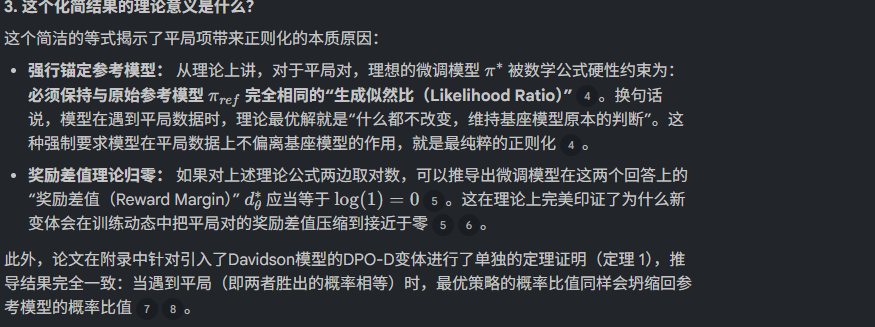

## 一句话直觉

==平局告诉模型“别强行拉开差距”，它本身就是一种有效监督。==

## 先理解问题

真实偏好数据包含质量相近、表达不同的回答。二元Bradley-Terry模型只能描述甲胜或乙胜，丢弃平局会浪费信息，随机强制胜负又会制造方向性噪声。

## 方法如何工作

TODO先以TOBT扩展偏好模型，在潜在效用差附近引入不确定区间，从而给胜、负、平分别赋概率；把DPO的策略/参考对数比代入后，==明确偏好与平局使用不同损失==。平局项在估计奖励差为零时不推动无意义更新，差值偏离零时则把两者拉回。

## 放回偏好对齐的地图

与三候选可识别性论文不同，这里的三元指两个候选的三种关系。平局要求隐式奖励差接近零，也不表示两个回答的原始生成概率必然相等，因为参考概率仍参与奖励定义。

## 阅读边界

原清单把TODO与DPO-RK相关讨论、反转平局标签实验和扩散迁移想法混写；这些不能全部归为TODO已验证结论。尤其“可以直接扩展Diffusion-DPO”应视为待检验研究设计。

## 目标结构摘记（原文第4.2节）

$$\mathcal L_{\mathrm{TODO}}=(1-I_{\rm tie})\mathcal L^{p}_{\mathrm{TODO}}+I_{\rm tie}\mathcal L^{t}_{\mathrm{TODO}}.$$

$I_{\rm tie}$表示是否平局；明确偏好项与平局项承担不同更新任务。

## 自测与动手

1. 若参考模型对两个平局回答概率不同，隐式奖励差为零时，新策略必须给相同原始概率吗？
2. 人为平局与标注者群体意见分裂，是否应总用同一个平局标签处理？

**小实验（自学设计）：**保持明确偏好数据不变，增加同样数量的平局对，比较丢弃平局、随机胜负与显式平局损失；交换平局对顺序，检查损失对称性。扩散迁移需另外验证去噪代理下的梯度行为。

## 来源与阅读范围

[论文原文](https://arxiv.org/abs/2411.02442)。已对照全文第4.1—4.3节（TOBT、两类损失与更新方向）；这份笔记聚焦这些章节，并未独立复现实验。

**核验补充：**DPO-RK与扩散迁移在原清单中混入本条；本笔记只把可对照TODO原文的TOBT机制归为论文结论。

原清单摘录与附图（保留原始表述）

以下内容来自原研究清单，可能包含旧标题、待验证的推测或尚未纠正的摘要。附图也可能是个人或 AI 辅助示意，未独立核验其出处与推导；阅读时以本页上方核验说明和论文原文为准。

**研究想法 #28**

这项研究针对大型语言模型（LLM）对齐中的偏好缺失问题，指出传统的DPO算法受限于二元BT模型，**无法有效处理样本中普遍存在的平局（Tie）数据。**为此，作者提出了TOBT模型，通过引入不确定性边界将偏好关系从二元扩展至三元结构。基于该理论构建的TODO算法，不仅能更精准地捕捉人类意图的多样性，还能在仅有二元数据的情况下表现出更强的稳健性。

Diffusion\-DPO采用了一种基于间隔的过滤策略，在预处理过程中去除低置信度或接近相等的偏好对。因此，模糊（类似平局）的监督信号被排除在训练之外，从而将模型简化为一个困难的二元偏好学习问题。

Diffusion\-DPO 采用一种基于边界（margin\-based）的过滤策略，在预处理阶段剔除置信度较低或偏好差异极小的样本对。这使得训练过程排除了具有歧义性（即结果难分伯仲）的监督信号，从而将学习任务简化为一种硬边界二元偏好优化问题。然而，这也导致了偏好分布的截断：模型仅接触到置信度高的比较样本，因而无法捕捉到扩散式生成输出中普遍存在的不确定性区域。**为了解决这一局限性，我们扩展了 Diffusion\-DPO，使其具有受 TOBT/TODO 启发的感知并列偏好公式，该公式明确地对模糊偏好区域进行建模，而不是将其丢弃。**

Diffusion\-DPO 把 preference learning 变成了 **truncated binary classification problem，而实际上应该是**learning from **truncated \+ ambiguous \+ full\-spectrum preference distribution**

Diffusion\-DPO 通过过滤掉低间隔样本来隐式地假设偏好可分离性，而我们认为被丢弃的区域包含结构化的不确定性，可以通过三元偏好公式来建模。可以直接将 TODO 扩展到 Diffusion\-DPO。**其动机在于，Diffusion\-DPO 采用了一种基于间隔的过滤策略，该策略会移除置信度低或偏好值接近相等的选项对，从而有效地将问题转化为一个难度较高的二元偏好学习任务。这会导致结构化歧义信息的丢失，而我们通过引入一种受 TOBT/TODO 启发的三元偏好公式（感知并列偏好的优化）来恢复这些信息。**

<figure><figcaption>原研究清单配图；出处与推导未独立核验。</figcaption></figure>

<figure><figcaption>原研究清单配图；出处与推导未独立核验。</figcaption></figure>

<figure><figcaption>原研究清单配图；出处与推导未独立核验。</figcaption></figure>

任何不允许平局可能性的模型，都没有充分利用‘无偏好’类别中所包含的信息

迁移到Diffusion\-DPO：

利用Pick\-a\-pic的平局数据做实验，引入平局项

- 在DPO\-RK（与TODO做法类似）中，优化目标包含了相互竞争的两项：对于明确胜负的数据，模型依然致力于扩大奖励差值；**但对于标记为“平局”的数据，模型的优化目标是将其奖励差值的绝对值最小化（即驱动两者差值趋向于零）**。模型通过动态调整梯度，学习到了如何同时对“胜出”和“平局”进行建模，这是原始DPO完全不具备的机制。

- 如果在原始的DPO模型中强行加入平局数据，会导致严重的任务性能下降。然而，**DPO\-RK在引入平局数据时，不仅不会出现性能下降，还能对参考模型（reference model）产生极强的正则化作用**。通过保持平局数据的偏好比例与参考模型一致，这两个变体能够**在更小的KL散度下（即更不容易偏离参考模型），实现比原始DPO更高的任务表现**

- 传统DPO会直接丢弃这些评价冲突的样本，而**DPO\-RK能够将这些由于评价冲突而产生的成对数据视为“平局”进行学习**

**如何证明效果增益是来自“平局项”，而非数据量增加？**

为了排除“数据量增加带来性能提升”这一干扰因素，论文设计了关键的对照实验，主要通过以下三个层面的对比来证明增益的真正来源：

1. **核心控制组：在完全相同的数据量下对比 **DPO\(CP\+TP\)** 与 **DPO\-RK\(CP\+TP\) 这是最核心的证明逻辑。论文对比了以下几种训练设置：

- **DPO\(CP\)**：仅使用明确偏好数据训练（基线）。

- **DPO\(CP\+TP\)**：使用明确偏好数据 \+ 平局数据，进行**原始DPO**训练。

- **DPO\-RK\(CP\+TP\)** ：使用明确偏好数据 \+ 平局数据，进行**带有平局项的新变体**训练。

这里 `DPO(CP+TP)` 与新变体使用的数据集**大小、内容完全一模一样**。

2. **原始DPO加入平局数据后，导致性能崩塌** 实验结果表明，如果只是单纯增加数据量（即在原始DPO中加入平局数据构成 `DPO(CP+TP)`），**不仅没有带来增益，反而导致了任务性能的显著下降**。因为原始DPO无法理解平局，它会强行把质量相似的TP数据视作一胜一负，从而给模型提供了错误的梯度信号，导致其生成能力受损

3. **只有引入平局项，才能在不损害性能的情况下获得正则化增益** 相反，当使用完全相同的数据量，但采用包含“平局优化项”的新变体 `DPO-RK(CP+TP)`  时，模型没有出现性能下降。更重要的是，**新变体实现了比单独使用CP数据（DPO\(CP\)）更低的KL散度（即更不容易偏离基座模型），从而在相同的偏离度下实现了更高的任务表现**。这证明了增益直接来源于新损失函数中对平局的特殊处理机制（将奖励差值最小化）。

4. **进一步验证：反转平局标签实验（rTP）** 在文本摘要任务中，为了进一步**证明平局项处理“无偏好方向”数据的优越性**，研究人员进行了一项精妙的测试：他们将平局数据（TP）中的胜者和败者互换，构造了“反转平局对”（rTP），并训练了 `DPO(CP+rTP)`。 结果显示，`DPO(CP+rTP)` 的表现与 `DPO(CP+TP)` 同样糟糕，而 `DPO-RK` 的表现依然大幅领先。这再次无可辩驳地证明：由于平局项使得模型不需要去强行区分谁胜谁负（没有偏好方向），这才是模型能力得到保护和提升的关键，绝非简单增加了配对数据。

**为什么平局项可以提升性能？**

加入平局项之所以能带来性能的提升，从理论角度来说，**核心确实在于它提供了一种极强的、内生的“正则化”（Regularization）机制**

<figure><figcaption>原研究清单配图；出处与推导未独立核验。</figcaption></figure>

<figure><figcaption>原研究清单配图；出处与推导未独立核验。</figcaption></figure>

在传统的DPO中，由于没有平局项，模型会把所有质量相似的数据都视为“必须分出胜负”，从而为了拉大微小差异而大幅修改参数，导致偏离参考模型（KL散度爆炸）并引发“奖励作弊（Reward Hacking）”——即生成极长但无意义的文本来骗取高分。

加入平局项后，训练数据中包含的大量平局对起到了\*\*“稳定锚”\*\*的作用。这些数据不断地通过损失函数向模型传递理论信号：“保持基座模型原有的好习惯，不要在这里乱动参数”。这使得模型在学习“清晰偏好”数据（提高特定任务表现）的同时，由于平局数据的牵制，不会过度拟合偏好数据而崩溃，最终在更小的模型偏移（低KL散度）下，实现了更优的整体生成性能

