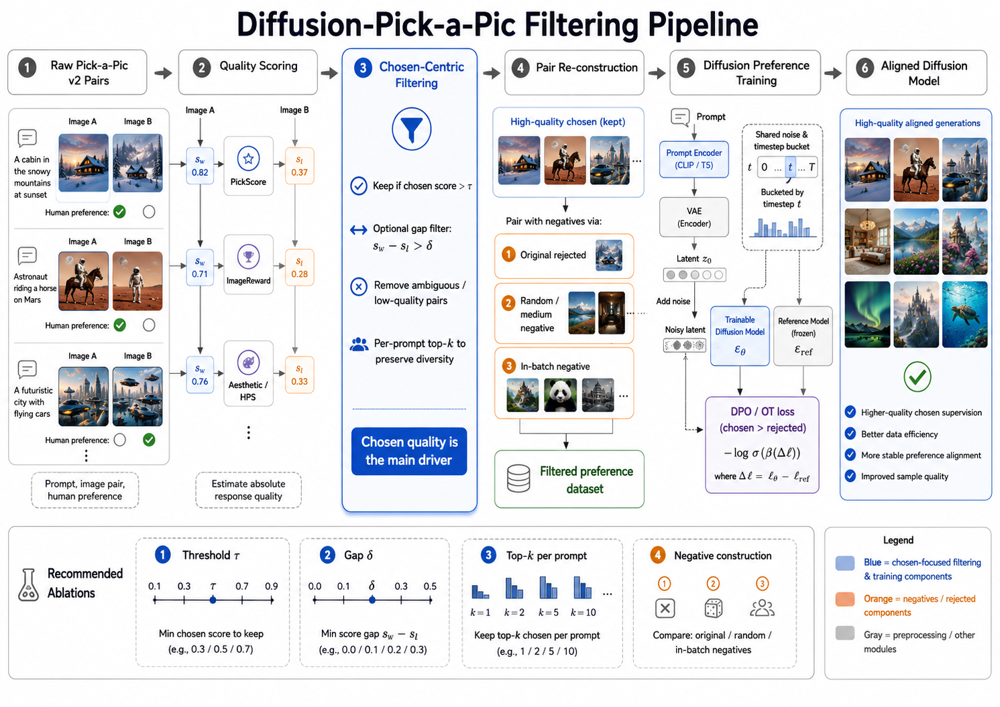

## 一句话直觉

==构建DPO数据时，先把chosen做好，可能比只追求更差的rejected更有效。==

## 先理解问题

偏好数据常以胜负差距或对比度衡量质量，但差距变大既可能因为chosen更好，也可能仅因为rejected更差。两种改变对最终生成能力不一定等价，需要拆开正负质量的作用。

## 方法如何工作

论文理论刻画偏好数据分布下的DPO最优响应分布，并进行数据质量控制实验，发现==chosen质量在其研究设置中占主导==，对比性带来的收益主要通过改善chosen体现；还研究特定在线DPO设定中与chosen SFT的联系，以及混合on-policy数据的作用。

## 放回偏好对齐的地图

这不等于“rejected永远无用”或“DPO无条件等价于SFT”。模型初始化、数据支持、偏好噪声及在线采样方式会改变结论适用范围，应把论文命题的条件与经验观察分开。

## 阅读边界

原清单重复收录本论文，已合并。学习时尤其要检查质量评估器是否与最终judge同源，以及chosen质量与回答长度、难度、提示分布是否混杂。

## 自测与动手

1. 如果只让rejected更差而chosen不变，为什么分类更容易却未必改善生成？
2. 怎样控制数据，才能区分chosen质量和pair margin的因果作用？

**小实验（自学设计）：**构造chosen高/低质量与rejected高/低质量的2×2数据，固定提示、样本数和训练预算；分别评估chosen似然与独立输出质量，并用长度匹配排除简单长度偏差。

## 来源与阅读范围

[论文原文](https://arxiv.org/abs/2508.18312)。已核对正式论文页面的题名与摘要；机制解释同时参照原研究清单，具体公式、证明与实验配置仍需阅读全文。

原清单摘录与附图（保留原始表述）

以下内容来自原研究清单，可能包含旧标题、待验证的推测或尚未纠正的摘要。附图也可能是个人或 AI 辅助示意，未独立核验其出处与推导；阅读时以本页上方核验说明和论文原文为准。

**研究想法 #38**

尽管DPO的应用日益广泛，但一个根本性问题仍未解决：**偏好数据的哪些特性对DPO性能最为关键？**本文从理论和实证两个角度系统地研究了偏好数据分布对DPO的影响。我们表明，**所选响应的质量在优化DPO目标中起主导作用，而被拒绝响应的质量影响相对有限。**理论分析刻画了DPO下的最优响应分布，并揭示了响应间的对比性主要通过提升所选样本的质量发挥作用。

---

**研究想法 #62**

直接偏好优化（Direct Preference Optimization，DPO）作为一种简单且有效的方法，已被用于使大型语言模型（LLMs）与人类偏好对齐，且无需依赖学习的奖励模型。尽管DPO的应用日益广泛，但一个根本性问题仍未解决：偏好数据的哪些特性对DPO性能最为关键？本文从理论和实证两个角度系统地研究了偏好数据分布对DPO的影响。**我们表明，所选响应的质量在优化DPO目标中起主导作用，而被拒绝响应的质量影响相对有限。理论分析刻画了DPO下的最优响应分布，并揭示了响应间的对比性主要通过提升所选样本的质量发挥作用。**我们进一步研究了在线DPO设置，发现其有效地简化为对所选响应的监督微调。跨多任务的大量实验验证了我们的结论：**提升所选响应的质量能够持续提升性能，而被拒绝响应的质量影响较小。**我们还探讨了混合策略数据的益处。研究结果解释了一些广泛采用策略的机制，并为构建高效偏好数据集以实现LLM对齐提供了实用见解。

<figure><figcaption>原研究清单配图；出处与推导未独立核验。</figcaption></figure>

