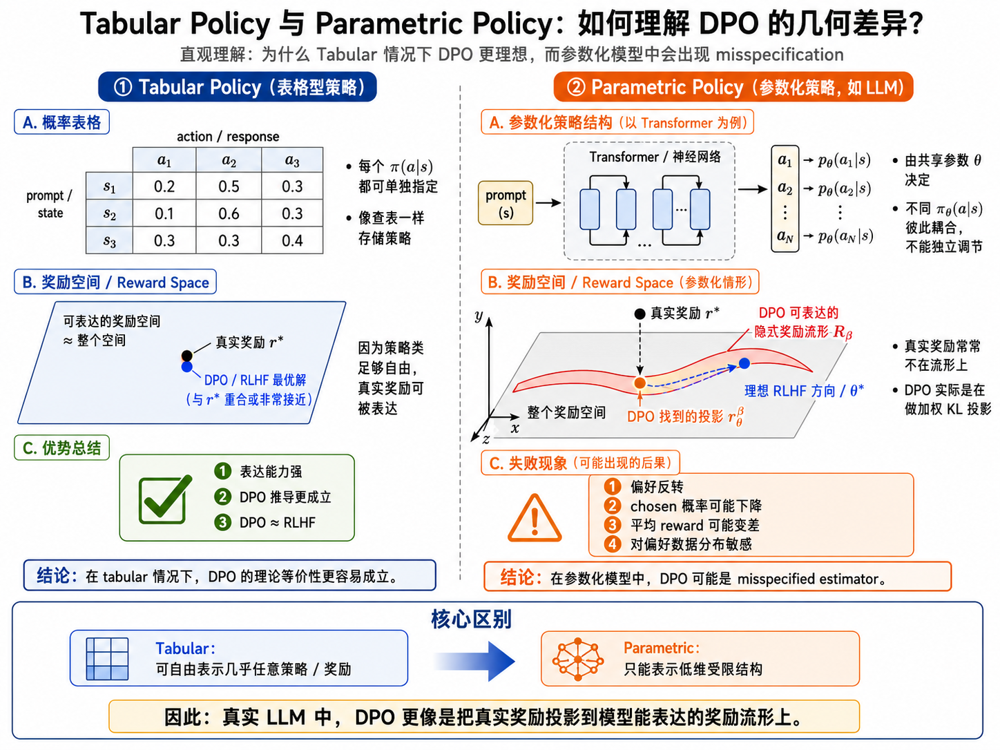

## 一句话直觉

==DPO能够表达的隐式奖励受策略模型族限制，真实奖励不在其中时，优化得更充分也可能学错。==

## 先理解问题

DPO由RLHF的最优策略关系推导而来，但实际训练只能在有限参数模型族中搜索。真实偏好奖励未必能写成这个模型族诱导的策略/参考对数比，这属于统计错设，而不只是数据少或训练不收敛。

## 方法如何工作

论文从奖励函数空间刻画DPO估计问题，研究错设下的偏好顺序反转、真实奖励变差及对数据分布敏感。AuxDPO加入辅助变量来==扩展奖励表示==，借助几何分析让更新更接近两阶段RLHF的局部行为。辅助变量的作用应从可表达空间理解，不能简单等同于另一个独立奖励模型。

## 放回偏好对齐的地图

与改margin、重加权样本不同，核心是“优化在什么奖励集合里发生”。这解释了为何同样偏好数据下DPO与RLHF未必无条件等价，也提醒我们区分无限表达能力的推导与受限模型的实现。

## 阅读边界

局部几何结论有近似范围，AuxDPO的实现也依赖辅助方向估计。阅读时应检查模型族、局部展开和辅助变量使用方式，不要从小型bandit例子直接推出大规模LLM必然失败。

## 自测与动手

1. 统计错设与优化未收敛分别会在增加训练步数时呈现什么差别？
2. 增大策略模型容量为何可能缓解错设，却不能自动消除偏好标签噪声？

**小实验（自学设计）：**用三个动作和受限参数策略构造bandit，使真实奖励不能由策略隐式奖励表达；比较DPO、显式奖励后策略优化与AuxDPO的排序和真实期望奖励，并增加数据量观察偏差是否仍在。

## 来源与阅读范围

[论文原文](https://arxiv.org/abs/2510.20413)。已核对正式论文页面的题名与摘要；机制解释同时参照原研究清单，具体公式、证明与实验配置仍需阅读全文。

原清单摘录与附图（保留原始表述）

以下内容来自原研究清单，可能包含旧标题、待验证的推测或尚未纠正的摘要。附图也可能是个人或 AI 辅助示意，未独立核验其出处与推导；阅读时以本页上方核验说明和论文原文为准。

**研究想法 #12**

**1\.问题：**

DPO 在真实的参数化模型中并不等价于两阶段 RLHF，它实际上是在做一个错设的奖励估计问题；当真实奖励无法被当前 policy class 表达时，DPO 可能出现偏好反转、平均 reward 下降、对偏好数据分布高度敏感等问题。（DPO的推导默认 policy class 是 tabular 的，也就是说模型可以表达任意条件分布。而真实 LLM 显然不是 tabular policy class，而是一个有限参数的 neural policy class。在非 tabular、低维参数化 policy class 中，DPO 最小化不等价于RLHF。）DPO 最小化等价于把真实 reward  投影到 DPO 能表达的 implicit reward manifold 上。

**2\.做法：**

**在 DPO 的 implicit reward 上加入一个辅助变量，让 reward 表达能力从低维 manifold 扩展到更大的空间。**

**3\.结论：**

1. 论文重新解释了 DPO：DPO 不是无条件等价于 RLHF，而是在 policy\-induced reward space 中做投影

2. 论文指出 DPO 的失败不是单纯来自数据不足或优化不充分。DPO 仍然可能失败，因为它的 reward model class 本身 misspecified。

3. 论文提出 AuxDPO，通过增加 null\-space auxiliary variables，扩展 reward 表达能力，从而更接近 RLHF 的局部解。

DPO 的理论等价性依赖 tabular policy 假设；在真实参数化模型中，DPO 实际上是在把真实 reward 投影到 policy 可表达的 implicit reward manifold 上，因此会产生 misspecification。AuxDPO 通过引入 null\-space auxiliary variables 扩展 reward 表达能力，使优化方向更接近两阶段 RLHF 的局部自然梯度解。

**4\.迁移到Diffusion\-DPO：**

DPO 的问题不是只在 pairwise loss，而是在于 implicit reward class 由 policy parameterization 限制，导致真实 reward/probability preference signal 发生 misspecification projection。**在 diffusion model 中，类似的 implicit reward 往往会落到轨迹概率、score matching 或 denoising likelihood ratio 上。**

<figure><figcaption>原研究清单配图；出处与推导未独立核验。</figcaption></figure>

